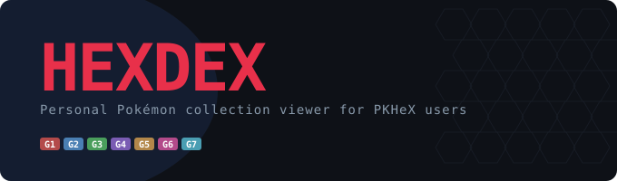



# HexDex

A desktop viewer for your personal Pokémon collection. HexDex reads individual Pokémon files exported from PKHeX and displays them in a searchable collection with artwork, stats, moves, evolution chains, notes, tags, and favourites.

Supports `.pk1` through `.pk7` files, covering Generations 1–7. HexDex views exported files; it does not edit them or open complete game saves.

## Features

- Search by species name or nickname, and filter by type, generation, tags, favourites, shinies, legendaries, or eggs.
- Sort your collection by Pokédex number, level, name, or shiny status.
- Inspect stats, IVs/DVs, EVs, moves, nature, trainer details, and evolution chains.
- Switch between multiple Pokémon of the same species and generation using variant tabs.
- Add notes and tags, mark favourites, and apply tags to multiple Pokémon at once.
- Scan subfolders and export collection data to CSV.
- Follow generation-specific links to Serebii for more information.
- Reuse locally cached Pokémon data and artwork after the initial download.

## Screenshots

### Collection view

### Detail view

## Getting HexDex

The project is moving to **GitHub Actions builds** for Windows downloads, replacing local executable builds.

An Actions workflow has not yet been added to this checkout. Once automated builds are configured, this section will be updated with the download location and release process.

The Windows package must include both `HexDex.exe` and its accompanying `_internal` folder. Extract the entire package before launching the application. A packaged build includes its Python runtime, so users do not need to install Python separately.

## Using HexDex

1. Export individual Pokémon files from PKHeX into a folder.
2. Open HexDex and choose that folder using **Browse**, or paste its path.
3. Enable **Subfolders** if your collection spans multiple folders.
4. Click **Scan**. The first scan downloads Pokémon information and artwork, so it requires an internet connection and may take a while.
5. Use the search and filters to browse your collection, then click a card to see its details.

Previously cached information and artwork can be used offline. Scanning Pokémon whose information has not been cached still requires an internet connection. Serebii links also require internet access.

### Notes, tags, and favourites

Each exported file has its own notes, tags, and favourite status. Use the detail panel to edit notes and tags, then click **Save**. To tag several Pokémon at once, enter selection mode, select their cards, and apply a tag.

Keep filenames unique across scanned subfolders: personal annotations are currently associated with filenames, so files sharing the same name can share annotations.

### CSV export

Click **CSV** to export the loaded collection. Choose where to save the file using the Save As dialog. The export includes Pokémon details, stats, moves, notes, tags, and favourites.

## Your data

HexDex stores downloaded information, artwork, and personal annotations in a local `cache/` folder. In a packaged build, this folder is created beside the executable, so keep the application somewhere it can write files.

**Back up `cache/notes.json`.** It contains your notes, tags, and favourites and cannot be recreated by downloading Pokémon data. When replacing the application with a newer build, preserve your cache folder and personal annotations.

The cache, Python environment, and generated executables are excluded from the source repository.

## Current limitations

- Supported inputs are PKHeX-exported `.pk1`–`.pk7` files; later generations and complete save files are not supported.
- Held items are displayed for Generations 2–4 where a recognised mapping exists. Generation 5–7 held items are not currently displayed.
- Folder browsing and CSV saving use dialogs on the computer running HexDex. The desktop application is the primary way to use these features.

## Development and builds

The application uses Python, Flask, and pywebview with the Qt backend. The interface uses HTML, CSS, and JavaScript without a separate frontend build step.

Source changes are intended to be committed to GitHub, with Windows executables built through GitHub Actions once the workflow is configured. Generated build output belongs in downloadable build packages rather than source commits.

Runtime dependencies are listed in `requirements.txt`. Build automation will also need PyInstaller and access to the application templates and icon.

## Credits

Pokémon information and artwork are provided through [PokéAPI](https://pokeapi.co/). Additional information links point to [Serebii](https://www.serebii.net/). Pokémon files are exported using [PKHeX](https://github.com/kwsch/PKHeX).

HexDex is an unofficial fan project and is not affiliated with Nintendo, Game Freak, or The Pokémon Company.
