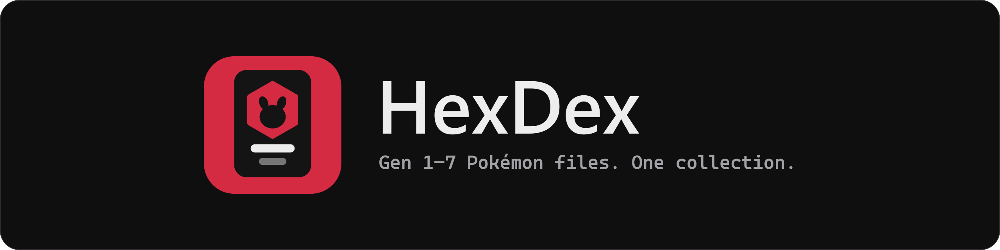
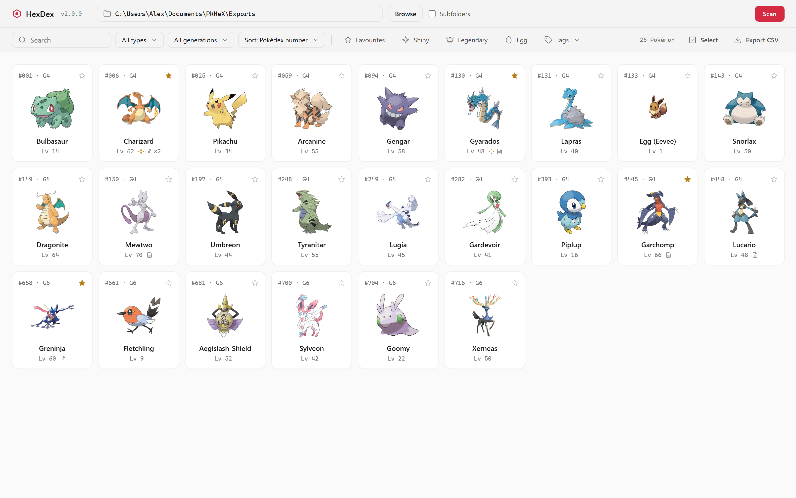
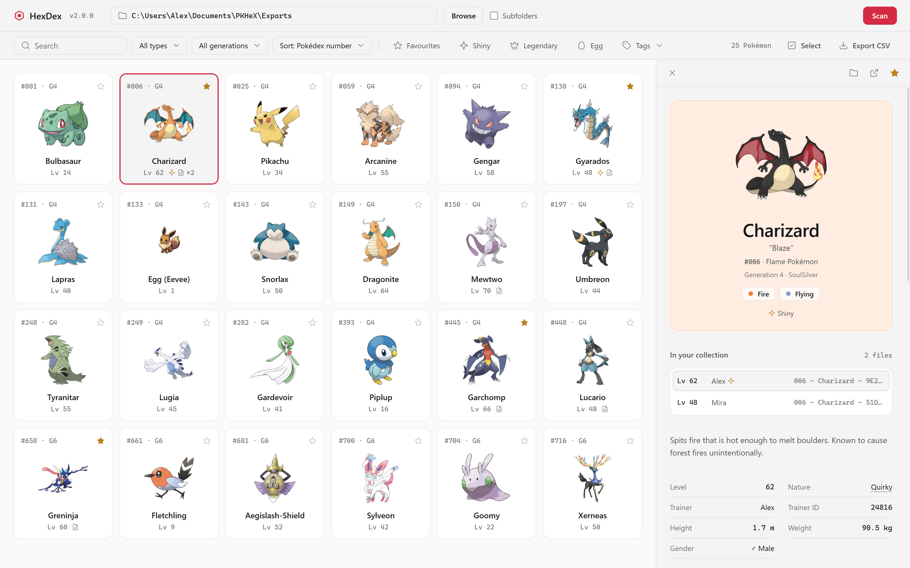

HexDex is a desktop viewer for Pokémon files that you export from PKHeX. It shows your `.pk1` to `.pk7` files (Generations 1 to 7) as one searchable collection. Each Pokémon shows its artwork, stats, moves and evolution chain. You can add notes, tags and favourites.

HexDex only reads your files. It does not change them, and it does not open complete game saves. No accounts and no tracking. Your notes stay on your computer.

Website: [tariqmk.github.io/HexDex](https://tariqmk.github.io/HexDex/)

<picture>
  <source media="(prefers-color-scheme: dark)" srcset="docs/images/collection-dark.png">
  
</picture>

## Features

- Search by species name or nickname.
- Filter by type, generation, tags, **Favourites**, **Shiny**, **Legendary** and **Egg**.
- Sort by Pokédex number, level, name, or shiny first.
- See stats, IVs or DVs, EVs, nature, moves, held item, trainer details and the evolution chain.
- See the six base stats as a hexagon in the Pokémon's type colour.
- Group several files of one species and generation on one card, with a tab for each file.
- Add notes and tags, and mark favourites. Tag many Pokémon at once with **Select**.
- Scan one folder, or a folder and its subfolders.
- Export the collection to a CSV file.
- Open the Pokémon's page on Serebii for its generation.
- Use cached data and artwork offline after the first scan.
- Light and dark appearance follow your system setting.
- Check for a newer release from the version label.

## Screenshots

<picture>
  <source media="(prefers-color-scheme: dark)" srcset="docs/images/detail-dark.png">
  
</picture>

## Download

Download HexDex from the [Releases page](https://github.com/TariqMK/HexDex/releases/latest). There are packages for Windows, macOS and Linux. Each package includes Python, so you do not have to install it.

| Platform | Package | Open |
| --- | --- | --- |
| Windows x64 | `HexDex-vX.Y.Z-windows-x64.zip` | `HexDex/HexDex.exe` |
| macOS Apple Silicon | `HexDex-vX.Y.Z-macos-arm64.zip` | `HexDex.app` |
| Linux x64 | `HexDex-vX.Y.Z-linux-x64.tar.gz` | `./HexDex/HexDex` |

`X.Y.Z` is the release version.

1. Download the package for your computer.
2. Optional: check the file against `SHA256SUMS.txt` from the same release.
3. Extract the whole package.
4. Open the file in the **Open** column.

**Note:** On Windows and Linux, keep the `_internal` folder beside the executable. HexDex does not start without it.

**Note:** Do not put HexDex in `Program Files`. HexDex saves its data beside the executable, and that folder is not writable.

**Note:** The macOS package is not signed or notarised. The first time you open it, macOS blocks it. Go to **System Settings > Privacy & Security** and select **Open Anyway**. Intel Macs are not supported.

**Note:** The Linux package is built on Ubuntu 22.04. It needs a graphical desktop and the system libraries for Qt. Other distributions can need more packages.

## Use HexDex

1. In PKHeX, export the Pokémon you want into one folder.
2. Open HexDex.
3. Select **Browse** and choose the folder. You can also paste the folder path.
4. If your files are in more than one folder, select **Subfolders**.
5. Select **Scan**.
   **Note:** The first scan downloads data and artwork for each species. It needs an internet connection and can take several minutes.
6. Use the search box, filters and sort menu to find a Pokémon.
7. Select a card to open the detail panel.
8. Press **Esc** or select the close button to close the panel.

### Scan progress

During a scan, a progress panel shows below the loading message. It updates about once a second and shows:

- the number of files done,
- the time since the scan started,
- the download in progress, and how long it has waited.

**Scan activity** shows the last four events, including failed downloads. Select it to collapse it.

The file count goes up when a file is complete. One file can need several downloads, so the count can stop for some seconds. The **Scan** button is disabled until the scan is complete. The panel closes when the collection loads. If the scan fails, the panel stays open.

### Notes, tags and favourites

Each file has its own notes, tags and favourite.

1. Open the detail panel.
2. Type a note, or add or remove a tag.
3. Leave the note field. HexDex saves the change and shows **Saved**.
4. To make a favourite, select the star.

To tag many Pokémon at once:

1. Select **Select**.
2. Select the cards you want.
3. Type a tag and select **Apply**.
4. Select **Done**.

**Caution:** HexDex links notes and tags to the file name. If two files in different subfolders have the same name, they share notes and tags. Give every file a unique name.

### Export to CSV

1. Select **Export CSV**.
2. Choose a location and a file name.
3. Select **Save**.

The CSV file contains each Pokémon's details, stats, moves, notes, tags and favourite status.

### Check for updates

The label beside the **HexDex** logo shows the version, for example `v3.0.0`. If you run HexDex from source, it shows **Development build**.

1. Select the version label.
2. Read the result in the **Check for updates** dialog.
3. If a newer release is available, select **Open release page**. Your browser opens the release, where you can download it.

HexDex does not download or install updates. It never checks for updates automatically.

### Report a problem

The **?** button beside the version label opens the **Help** menu.

1. Select **?** > **Report a Problem…**. Your browser opens a bug report on GitHub. Your HexDex version and operating system are already filled in.
2. Describe what happened and how to make it happen again.
3. Optional: attach screenshots and the log file (see **View the log file**).
4. Select **Submit new issue**.

You can also [report a bug](https://github.com/TariqMK/HexDex/issues/new?template=bug.yml) or [suggest an idea](https://github.com/TariqMK/HexDex/issues/new?template=idea.yml) on GitHub.

> [!NOTE]
> You need a free GitHub account to send a report. Nothing is sent until you select **Submit new issue** on GitHub.

### View the log file

HexDex records what it does and any errors in `HexDex-data/HexDex.log`. The log helps find the cause of a problem.

1. Select **?** > **View Logs**.
2. The file manager opens at the log file: Finder on macOS, File Explorer on Windows, the `HexDex-data` folder on Linux.
3. Attach `HexDex.log` to your bug report.

If the file manager does not open, HexDex shows the path to the log file. Select **Copy Path** to copy it.

## Your data

HexDex keeps all its data in a `HexDex-data` folder beside the app. HexDex makes the folder when it starts for the first time.

- Windows and Linux: `HexDex-data` is in the same folder as `HexDex.exe` or `HexDex`.
- macOS: `HexDex-data` is in the same folder as `HexDex.app`, not inside it.

| File | Contents |
| --- | --- |
| `HexDex-data/notes.json` | Your notes, tags and favourites |
| `HexDex-data/pokeapi_cache.json` | Downloaded Pokémon data |
| `HexDex-data/images/` | Downloaded artwork |
| `HexDex-data/last_dir.txt` | The last folder you scanned |
| `HexDex-data/HexDex.log` | A record of what HexDex did and any errors. It keeps about the newest 1 MB |

To move HexDex to a different folder or computer, move the app and its `HexDex-data` folder together.

**Caution:** Back up `HexDex-data/notes.json`. HexDex cannot download it again. All other files download again on the next scan.

To move to a new version:

1. Extract the new version.
2. Copy the `HexDex-data` folder from the old version to the folder that contains the new app.

### Data from older versions

Versions before the `HexDex-data` folder kept data in a `cache` folder beside the executable. On macOS, that folder is inside the old `HexDex.app`, at `HexDex.app/Contents/MacOS/cache`.

When HexDex starts and finds no `HexDex-data` folder, it copies the `cache` folder next to its executable into `HexDex-data`. It does not change or delete the old folder.

To keep your notes from an older version:

1. Copy the old `cache` folder to the folder that contains the new app.
2. Rename it to `HexDex-data`.

**Note:** On macOS, copy the `cache` folder out of the old `HexDex.app` before you delete the old app.

## Privacy

- No accounts, telemetry, analytics or tracking.
- Your notes, tags and favourites stay in the `HexDex-data` folder on your computer.
- HexDex reads your Pokémon files. It never changes, moves or deletes them.
- Cached data and artwork work offline. Only data that is not cached yet needs the internet.
- HexDex keeps a log file, `HexDex.log`, in the `HexDex-data` folder. It records what the app does and any errors, including file and folder names, to help fix problems. It never records your notes or tags. Your home folder shows as `~`. It never leaves your computer unless you send it. To find it, select **?** > **View Logs**.

HexDex connects to the internet only for these features:

- **Scan:** downloads Pokémon data that is not cached yet from PokéAPI (`pokeapi.co`), and artwork from GitHub (`raw.githubusercontent.com`).
- **Serebii links:** open `serebii.net` in your browser, only when you select them.
- **Check for updates:** sends one request to GitHub (`api.github.com`) for the latest release, only when you select the version label. It sends nothing else and downloads nothing.
- **Report a Problem:** opens a page on GitHub in your browser. Nothing is sent until you submit it there.

The HexDex website loads no third-party fonts, analytics or trackers. It asks GitHub (`api.github.com`) for the latest release to show the version and the download links.

## Limitations

- HexDex reads only `.pk1` to `.pk7` files exported from PKHeX. It does not read Generation 8 or 9 files, or complete save files.
- Held items show for Generations 2 to 4. Held items for Generations 5 to 7 do not show.
- Types, abilities and base stats are the values from current games, not from the file's own game.
- **Browse** and **Export CSV** open dialogs on the computer that runs HexDex.

## Run from source

You need Python 3.10 or newer. The release builds use Python 3.12.

1. Clone the repository and open its folder.
2. Make a virtual environment:

   ```bash
   python3 -m venv venv
   ```

3. Install the dependencies.

   macOS and Linux:

   ```bash
   venv/bin/python -m pip install -r requirements.txt
   ```

   Windows:

   ```bat
   venv\Scripts\python.exe -m pip install -r requirements.txt
   ```

4. Start HexDex.

   macOS and Linux:

   ```bash
   venv/bin/python launch.py
   ```

   Windows:

   ```bat
   venv\Scripts\python.exe launch.py
   ```

**Note:** Use the `python` in `venv`, not the `python` on your PATH. This prevents conflicts with other environments.

**Note:** HexDex uses port 5000. On macOS, AirPlay Receiver can use port 5000. If HexDex does not start, turn off AirPlay Receiver in **System Settings > General > AirDrop & Handoff**.

From source, the `HexDex-data` folder is in the project folder. Git ignores it.

### Run the tests

```bash
venv/bin/python -m unittest discover -s tests
```

On Windows, use `venv\Scripts\python.exe` in place of `venv/bin/python`.

The tests make their own sample files. To also test real exports, put `.pk1` to `.pk7` files in `Meta/test-pokemon/`. Git ignores that folder, so your files stay private.

### Run the end-to-end check

`scripts/check_e2e.py` drives a running HexDex through its local API. It scans a made-up sample file in a new, empty folder, and checks the results, notes, the log file and that the sample file did not change. It uses only the Python standard library.

> [!CAUTION]
> The check saves a note for its sample file. Run it against a test copy of HexDex with its own `HexDex-data` folder, not your own collection.

1. Start a test copy of HexDex. The first scan needs the internet.
2. Run the check:

   ```bash
   python3 scripts/check_e2e.py --url http://127.0.0.1:5000 --version 3.0.1 --data <test copy>/HexDex-data
   ```

3. Read the result line. `RESULT: PASS` means every check passed.

Leave out `--version` for a development build.

## Creating a release

The workflow `.github/workflows/build.yml` runs only when you start it. Pushing commits or tags does not start a build.

1. Commit and push the changes for the release.
   **Note:** The workflow must be on the default branch. If it is not, the **Run workflow** button does not show.
2. Open [Actions > Build and release HexDex](https://github.com/TariqMK/HexDex/actions/workflows/build.yml).
3. Select **Run workflow**.
4. Select the branch to build.
5. Select the version increment:
   - **patch** (default): fixes, for example `1.8.2` to `1.8.3`.
   - **minor**: new features, for example `1.8.2` to `1.9.0`.
   - **major**: changes that break compatibility, for example `1.8.2` to `2.0.0`.
6. Select **draft** (default) to test first, or **public** to publish when the build is complete.
7. Select **Run workflow**.
8. For a draft: open it from the workflow summary or the Releases page, test the packages, edit the notes, then select **Publish release**.

The workflow builds Windows x64, macOS Apple Silicon and Linux x64. All three builds must pass, or the workflow makes no release and no tag. A release contains the three packages, `SHA256SUMS.txt` and generated release notes.

How the version is set:

- The workflow finds the highest `vMAJOR.MINOR.PATCH` in the tags and releases, including drafts, and applies the increment.
- A draft keeps its version number. The next build gets a new number.
- With no tags, the workflow starts from `0.0.0`.
- The workflow writes the version into `build-version.json` in the package. The source code always shows **Development build**.

Other facts:

- Only one release runs at a time, so two releases cannot get the same version.
- The workflow never overwrites a published release.
- If publishing fails, a draft can stay. Run the failed job again to continue.
- Drafts are visible only to users with write access to the repository.
- Actions keeps build artifacts for 30 days. Release files stay until you delete them.

## Update the brand images

The icon master is `assets/icons/hexdex_icon.svg`.

1. Edit `assets/icons/hexdex_icon.svg`, or the name, tagline and colours at the top of `assets/make_assets.py`.
2. Run `venv/bin/python assets/make_assets.py`.

The script writes these files:

- `assets/icons/`: `hexdex_icon.png`, `hexdex_icon.ico`, `hexdex_icon.icns`
- `docs/images/`: `banner.png`, `social-card.png`
- `docs/`: `icon.svg`, `apple-touch-icon.png`

To use the social card on GitHub:

1. Open the repository and select **Settings**.
2. Under **General**, go to **Social preview**.
3. Select **Edit** > **Upload an image**.
4. Choose `docs/images/social-card.png`.

## Update the screenshots

1. Run `venv/bin/python assets/make_screenshots.py`.
2. Check the four images in `docs/images/` before you commit them.

The script opens the real interface with 25 made-up Pokémon. It saves the collection view and the detail view, in light and dark. It keeps its data in `Meta/screenshot-cache/`, so your own collection, notes and folders do not show.

**Note:** The first run downloads data and artwork for the sample species. Later runs work offline.

## Update the website

The website is `docs/index.html`, `docs/style.css` and `docs/app.js`. It has no build step. GitHub Pages serves `docs/` from the `main` branch, so a push to `main` updates the website.

To preview it on your computer:

1. Run `venv/bin/python -m http.server 8765 --bind 127.0.0.1 --directory docs`.
2. Open `http://127.0.0.1:8765/`.

The app previews on the website are built in HTML with sample data and generic silhouettes. The website contains no Pokémon artwork. To change the sample data, edit `docs/app.js`.

**Note:** The download links find release files by the end of their names, for example `windows-x64.zip`. If you rename the release files, also change `ASSET` in `docs/app.js`. Until you do, the links open the Releases page.

## Repository layout

```text
HexDex/
├── launch.py               # Desktop window launcher
├── app.py                  # Backend: file parsing, data downloads, local storage
├── app_log.py              # Log file (HexDex.log) and View Logs
├── item_names.py           # Held item names for each generation
├── update_check.py         # Check for updates
├── requirements.txt        # Runtime dependencies
├── templates/
│   └── index.html          # Application interface
├── tests/                  # Parser, held item, update check and log file tests
├── scripts/
│   └── check_e2e.py        # End-to-end check of a running HexDex
├── .github/
│   ├── workflows/build.yml # Windows, macOS and Linux builds and releases
│   └── ISSUE_TEMPLATE/     # Bug report and feature idea forms
├── assets/
│   ├── icons/              # Icon master (SVG) and its PNG, ICO and ICNS files
│   ├── make_assets.py      # Makes the icons, banner and social card
│   └── make_screenshots.py # Makes the README screenshots with sample data
└── docs/                   # GitHub Pages website
    ├── index.html, style.css, app.js
    ├── icon.svg, apple-touch-icon.png
    └── images/             # Banner, social card and screenshots
```

## Credits

Pokémon data and artwork come from [PokéAPI](https://pokeapi.co/). The information links go to [Serebii](https://www.serebii.net/). You export Pokémon files with [PKHeX](https://github.com/kwsch/PKHeX).

HexDex is an unofficial fan project. It is not affiliated with Nintendo, Game Freak or The Pokémon Company.
