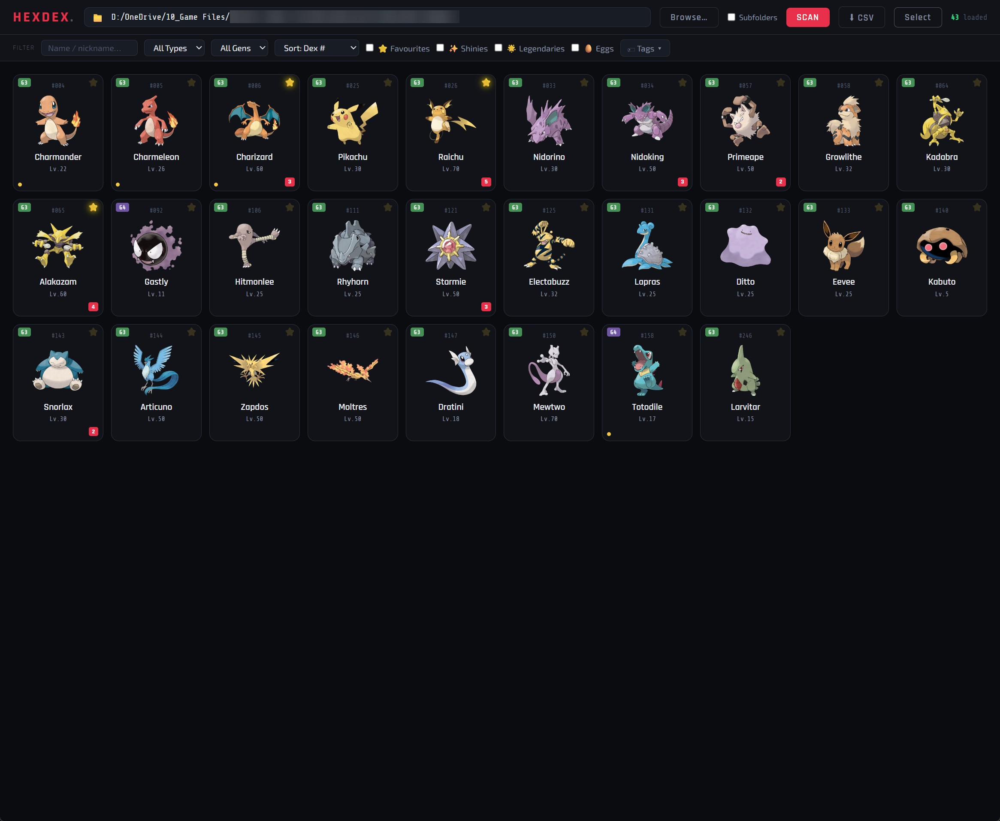
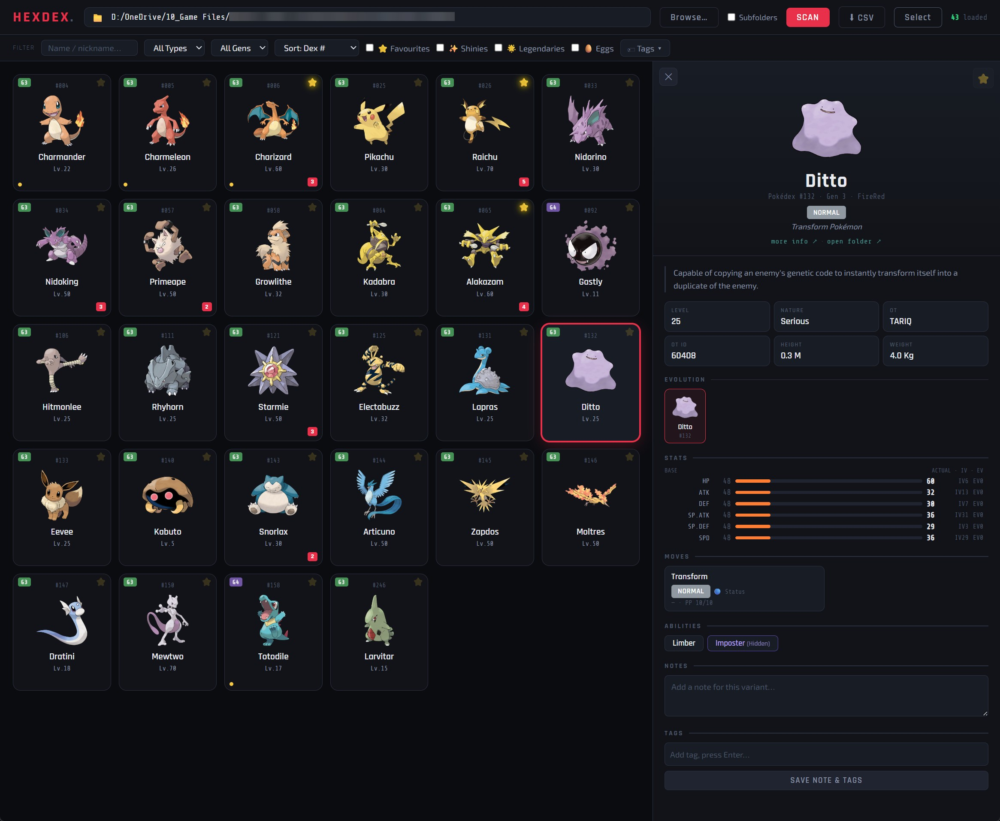

# HexDex

A desktop viewer for your personal Pokémon collection. HexDex reads individual Pokémon files exported from PKHeX and displays them in a searchable collection with artwork, stats, moves, evolution chains, notes, tags, and favourites.

Supports `.pk1` through `.pk7` files, covering Generations 1–7. HexDex views exported files; it does not edit them or open complete game saves.

## Features

- Search by species name or nickname, and filter by type, generation, tags, favourites, shinies, legendaries, or eggs.
- Sort your collection by Pokédex number, level, name, or shiny status.
- Inspect stats, IVs/DVs, EVs, moves, nature, trainer details, and evolution chains.
- Switch between multiple Pokémon of the same species and generation using variant tabs.
- Add notes and tags, mark favourites, and apply tags to multiple Pokémon at once.
- Scan subfolders and export collection data to CSV.
- Follow generation-specific links to Serebii for more information.
- Reuse locally cached Pokémon data and artwork after the initial download.
- Follow scan progress in a compact activity panel beneath the loading message.
- Find the installed build version beneath the HEXDEX logo.

## Screenshots

### Collection view



### Detail view



## Getting HexDex

GitHub Actions builds downloadable packages for **Windows (x64), Linux (x64), and macOS (Apple Silicon only)**.

Download the package for your operating system from [GitHub Releases](https://github.com/TariqMK/HexDex/releases/latest), then extract it. Only published releases are available publicly.

| Platform | Package | Launch |
| --- | --- | --- |
| Windows x64 | `HexDex-vX.Y.Z-windows-x64.zip` | Open `HexDex/HexDex.exe` |
| Linux x64 | `HexDex-vX.Y.Z-linux-x64.tar.gz` | Run `./HexDex/HexDex` from the extracted directory |
| macOS Apple Silicon | `HexDex-vX.Y.Z-macos-arm64.zip` | Open `HexDex.app` |

`X.Y.Z` is the release version. Each release also includes `SHA256SUMS.txt` for checking download integrity.

Extract the entire package. Windows and Linux builds need their accompanying `_internal` folder. Packaged builds include their Python runtime, so users do not need to install Python separately.

The macOS package is not signed with an Apple Developer certificate or notarised. macOS may require approval in **System Settings → Privacy & Security** before it can be opened. Intel Macs are not supported by this build.

Linux builds target Ubuntu 22.04 or newer compatible distributions and require a graphical desktop plus the system libraries used by Qt. Other Linux distributions may need additional packages.

## Using HexDex

1. Export individual Pokémon files from PKHeX into a folder.
2. Open HexDex and choose that folder using **Browse**, or paste its path.
3. Enable **Subfolders** if your collection spans multiple folders.
4. Click **Scan**. The first scan downloads Pokémon information and artwork, so it requires an internet connection and may take a while.
5. Use the search and filters to browse your collection, then click a card to see its details.

Previously cached information and artwork can be used offline. Scanning Pokémon whose information has not been cached still requires an internet connection. Serebii links also require internet access.

### Scan progress

During a scan, a small panel appears beneath the loading message in the centre of the collection area. It updates about once a second with files processed, elapsed time, and the current download, including how long the request has been waiting.

**Scan activity** shows the four most recent events, including download failures. You can collapse it for a quieter display. The panel disappears when the collection loads and remains visible if the scan fails.

First scans can take longer because HexDex downloads species information, moves, abilities, evolution chains, and artwork sequentially. The file count advances when each file finishes processing, so it may pause while several downloads complete for one Pokémon. The SCAN button is disabled during a scan to prevent overlapping scans.

### Build version

The small label beneath the **HEXDEX** logo shows the packaged release version, for example `v1.8.5`. Local Python runs show **Development build**. Draft and public packages carry the same version; publishing a draft does not change its contents.

### Notes, tags, and favourites

Each exported file has its own notes, tags, and favourite status. Use the detail panel to edit notes and tags, then click **Save**. To tag several Pokémon at once, enter selection mode, select their cards, and apply a tag.

Keep filenames unique across scanned subfolders: personal annotations are currently associated with filenames, so files sharing the same name can share annotations.

### CSV export

Click **CSV** to export the loaded collection. Choose where to save the file using the Save As dialog. The export includes Pokémon details, stats, moves, notes, tags, and favourites.

## Your data

HexDex stores downloaded information, artwork, and personal annotations in a local `cache/` folder. In a packaged build, this folder is created beside the executable, so keep the application somewhere it can write files.

**Back up `cache/notes.json`.** It contains your notes, tags, and favourites and cannot be recreated by downloading Pokémon data. When replacing the application with a newer build, preserve your cache folder and personal annotations.

The cache, Python environment, and generated executables are excluded from the source repository.

## Current limitations

- Supported inputs are PKHeX-exported `.pk1`–`.pk7` files; later generations and complete save files are not supported.
- Held items are displayed for Generations 2–4 where a recognised mapping exists. Generation 5–7 held items are not currently displayed.
- Folder browsing and CSV saving use dialogs on the computer running HexDex. The desktop application is the primary way to use these features.

## Development and builds

The application uses Python, Flask, and pywebview with the Qt backend. The interface uses HTML, CSS, and JavaScript without a separate frontend build step.

The workflow in `.github/workflows/build.yml` runs **manually only**. Pushing commits or tags does not trigger a build.

To build a draft or publish a release:

1. Commit and push the changes you want to release. The workflow must be present on the repository's default branch for the manual run button to appear.
2. Open [Actions → Build and release HexDex](https://github.com/TariqMK/HexDex/actions/workflows/build.yml) and click **Run workflow**.
3. Select the branch to build and choose the version increment:
   - **Patch** (default): fixes, such as `1.8.2` → `1.8.3`.
   - **Minor**: compatible new features, such as `1.8.2` → `1.9.0`.
   - **Major**: breaking changes, such as `1.8.2` → `2.0.0`.
4. Choose **draft** (default) to test before publishing, or **public** to publish automatically after a successful build.
5. Run the workflow. After all three platform builds succeed, it creates a versioned GitHub Release with the packages, checksums, and automatically generated release notes.
6. For a draft, open it from the workflow summary or Releases page, test the packages, then edit the notes and click **Publish release** when ready.

The workflow calculates the next version from the highest existing stable `vMAJOR.MINOR.PATCH` version across repository tags and releases, including drafts. Drafts reserve their version so the next build receives a new number. With no matching tags, it starts from `0.0.0` before applying the chosen increment. Prerelease and unrelated tags are ignored. The increment is selected explicitly because the workflow cannot reliably infer whether changes are breaking.

Release runs are serialized to avoid duplicate version numbers. The tag points to the exact commit selected for the run. Build failures do not create a release or tag; publication failures may leave a draft that can be resumed by rerunning the failed job. Published releases are never overwritten. Draft releases are visible to repository users with write access; source code and Actions logs remain public in a public repository. Published release downloads remain available independently of the temporary Actions artifacts, which are retained for 30 days.

Runtime dependencies are listed in `requirements.txt`. The workflow installs PyInstaller and defines its packaging options directly, including the templates, Qt backend, and application icon. It does not depend on the local spec in the ignored `Meta/` folder. Generated build output belongs in downloadable build packages rather than source commits.

Actions embeds the calculated version in `build-version.json` and checks that it matches the release version before packaging. Both version calculation and release creation have the repository permission needed to see draft releases; platform build jobs retain read-only repository access.

For local development checks, run `venv\Scripts\python.exe launch.py` on Windows (or use the local `start.bat`). This exercises the desktop interface, but packaged downloads still need testing on their target operating systems before publishing.

### Repository layout

```text
HexDex/
├── app.py                  # Backend, Pokémon parsing, and local storage
├── launch.py               # Desktop window launcher
├── requirements.txt        # Runtime dependencies
├── .github/
│   └── workflows/
│       └── build.yml       # Windows, Linux, and Apple Silicon builds
├── templates/
│   └── index.html          # Application interface
├── assets/
│   └── icons/              # Application icon
└── docs/
    └── images/             # README banner and screenshots
```

## Credits

Pokémon information and artwork are provided through [PokéAPI](https://pokeapi.co/). Additional information links point to [Serebii](https://www.serebii.net/). Pokémon files are exported using [PKHeX](https://github.com/kwsch/PKHeX).

HexDex is an unofficial fan project and is not affiliated with Nintendo, Game Freak, or The Pokémon Company.
